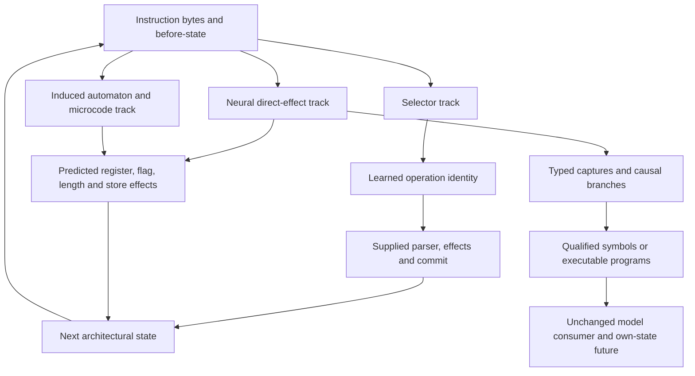
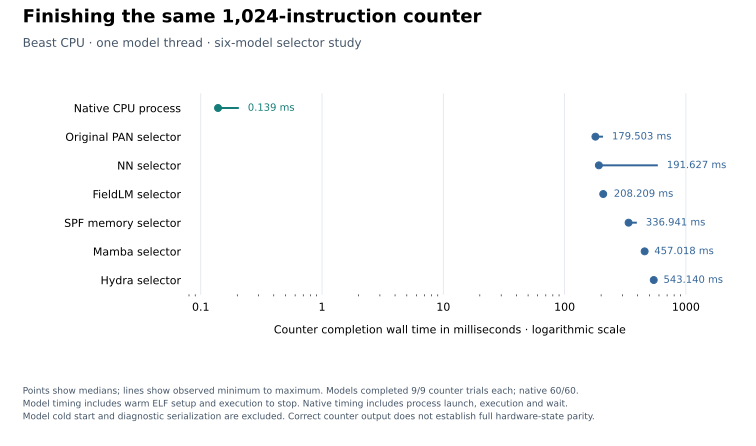

# Learning and recovering an instruction executor

**Results through October 30, 2026.** Small learned executors now compute restricted x86 register and flag effects, expose editable operand/context interfaces and yield executable programs with measured applicability. Their strongest successes coexist with long-program failures, unseen-address errors and collateral changes. This account connects those results to the preceding [PAN-ISA executor](../pan-isa/README.md).

## Abstract

An instruction executor is a useful small organism for studying learned computation: its inputs, state transitions and downstream uses can be observed precisely. The research progressed through three distinct targets. First, six adapters selected operations whose arithmetic and architectural commit were supplied. This exposed operand-invariance failures that high aggregate accuracy concealed. Second, NN, Mamba-style and Hydra-style executors emitted register bits, flags, lengths and memory effects directly, while structural SPF and FieldLM lanes induced explicit bit automata and microcode under stronger priors. Third, frozen executors became objects of causal investigation: native state edits, response-law recovery, streaming parameter programs and recipient-local value/context construction.

The evidence supports learned effects and useful, inspectable computational interfaces within named profiles. It also preserves composition failures, an unsuccessful latent-register lane, collateral output errors and counterexamples to compact response programs. A source-faithful parameter export and a compact semantic program answer different questions. Neither the original selector results nor the later partial compilations establish a general recovered x86 ISA, lossless neural compression or competitive hardware execution.

## What it means to learn an instruction

Let $b_t$ be the current instruction window and $s_t$ architectural before-state. A selector computes an operation identity $a_t=f_\theta(b_t,s_t)$, then a supplied transition library computes

$$
\hat s_{t+1}=T_{a_t}(b_t,s_t).
$$

Correct behavior can therefore mean that the network recognized ADD while ordinary code performed addition, flags, register selection and memory updates. This is a substantive recognition problem, but it does not establish a learned ALU.

A direct-effect executor instead computes $\hat s_{t+1}=F_\theta(b_t,s_t)$. In its baseline neural form, every emitted register bit, including untouched registers, comes from the model. A host ABI thresholds logits, advances the fetch position by the predicted length, performs emitted stores and services the declared Linux boundary. These supplied interfaces must remain visible even when arithmetic is learned.

There are also two meanings of “native” here. **Native model execution** means the frozen neural implementation and its unchanged learned suffix. **Native hardware execution** means Linux running x86 instructions on the processor. Equality to the first does not establish equality to the second.

Notation below uses $i$ for bit position, $c$ for expanded channel, $k$ for state mode, $H$ for selective-scan state, $D$ for decay, $W$ for a local state write, and $C$ for a state reader. A decoder broadcast called $C$ in the NN editing experiments is a different object, explicitly identified there. A model call, bit-clock step and program instruction are different time coordinates.

## The common comparison and its supplied priors

The initial `x86-al8-v1` profile contains eleven known forms: NOP; immediate MOV, ADD, SUB, XOR, AND, OR, CMP and TEST on AL; and INC/DEC AL. State contains AL, preserved BL, RIP and CF/ZF/SF/OF. Discovery, feedback, sealed heldout and optional terminal panels are distinct. Immediate and initial-AL residues separate splits, while fixed-byte forms recur. This tests operand/state and sequence generalization within known families.

The larger PAN-native comparison covers 452 staged forms and 33 executable runtime families, implemented scalar/stack/branch, SIMD-memory and x87 subsets, ten Linux services, a mixed 18-step program, static ELF loading and a separate continuous-safe 8,192-step Stage 3 probe. Staged heads receive decoded operation identities; the runtime head sees padded instruction bytes and numeric context. The scopes must not be pooled into one “x86 accuracy.”

| Adapter | Acquired state | Important supplied structure |
|---|---|---|
| Independent NN | Byte embeddings, MLP and staged heads | Candidate vocabulary, staged operation identities, runtime numeric features, all effects |
| Original PAN networks | Original factorized Stage 0–4 architectures and nested runtime head, freshly fitted | Original parsing, typed state, effects and commit |
| FieldLM fabric adapter | Discovery-derived route records in `FieldFabric`/`RoleChartField` | Operand-invariant keys; exact record lookup and supplied effects |
| SPF phase-memory adapter | Route records packed as SPF phase words | Same invariant keys, exact-match selection and supplied effects |
| Mamba-style selector | Small causal selective-state-space heads | Same decoded/runtime inputs and effects as neural baselines |
| Hydra-style selector | Shifted bidirectional SSD heads | Same inputs/effects; bidirectionality stays inside the supplied current window |

The starter NN embeds two bytes into 16 coordinates, concatenates seven state/length features and applies a 23→64→11 GELU MLP. The larger independent runtime NN embeds each of fifteen bytes into eight coordinates and concatenates 42 numeric features before a 64-unit hidden layer and 33-way classifier. The PAN runtime head retains its original 15-byte encoding and two 96-unit ReLU layers; old trained weights and the old epoch loop are not reused.

The structural adapters infer which supplied candidate explains discovery transitions. FieldLM then stores string-keyed records and reads them through a fabric program. The selector SPF arm represents key/value codes on the unit circle and uses native integer exact-match reads. Its identity phase characters copy codes; phase arithmetic is not the mechanism of arithmetic execution. This arm is **a phase-memory adapter, not a full SPFTransformer**. Its literal-invariance chart explicitly removes distinctions that neural classifiers must learn to ignore. The [source snapshots](sources/README.md) expose these differences.

## Mamba and Hydra equations

Both are small PyTorch reference implementations, rather than pretrained language models or official fused-kernel benchmarks. Selector mixers use width 16, expansion two and four state modes. Stage heads scan BOS, operation and context tokens; runtime heads scan fifteen byte embeddings, pool first/mean/last outputs and append numeric features. State resets for every request. Later direct-effect models reuse these mixers at width 48 across 64 bit-position tokens.

For Mamba, RMS-normalized input is projected into $u$ and a gate. A causal depthwise convolution and SiLU transform $u$. A linear selection emits a scalar delta precursor plus four-coordinate $B_i,C_i$; a separate projection and softplus produce channel-specific positive $\Delta_{i,c}$. The executed recurrence is

$$
A_{c,k}=-\exp(a_{c,k}),\quad
D_{i,c,k}=\exp(\Delta_{i,c}A_{c,k}),\quad
W_{i,c,k}=\Delta_{i,c}u_{i,c}B_{i,k},
$$
$$
H_i=D_i\odot H_{i-1}+W_i,\qquad
y_{i,c}=\sum_k H_{i,c,k}C_{i,k},
$$
$$
\operatorname{Mixer}(x)_i=x_i+
\operatorname{Linear}_{out}\big[(y_i+d\odot u_i)\odot\operatorname{SiLU}(g_i)\big].
$$

The implementation uses associative doubling over affine updates. Combining an earlier pair $(D_a,W_a)$ with a later pair $(D_b,W_b)$ gives $(D_bD_a,W_b+D_bW_a)$. This is mathematically the sequential recurrence; floating-point association can differ. The reference doubling implementation performs $O(TDN\log T)$ arithmetic work in logarithmic rounds for length $T$, channel count $D$ and state size $N$; it is not the work-optimal fused Mamba scan. The later sequential lowering uses $O(TDN)$ recurrence work.

Hydra starts from one shared noncausal depthwise convolution of the projected input and directional $B/C$ channels. Four heads have scalar negative transitions, shared across the channels within each head, plus separate forward/reverse deltas. Let $f_i$ and $r_i$ be inclusive forward and reverse scan outputs. Its executed off-diagonal construction is

$$
v_i=f_{i-1}+r_{i+1}+\operatorname{diag}(u_i)\odot u_i,
$$
$$
\operatorname{Mixer}(x)_i=x_i+
\operatorname{Linear}_{out}\big[\operatorname{RMS}(v_i)\odot\operatorname{SiLU}(g_i)\big],
$$

with boundary directional outputs zero. The code reverses a second batch, runs both directional scans, shifts them one position and reverses back. The learned diagonal is a linear function of $u_i$, repeated within heads. This distinguishes Hydra from simply adding an ordinary forward and backward Mamba output. Bidirectionality stays within the supplied window or bit-position tokens, without future architectural states. A fifteen-byte fetch can include bytes of subsequent instructions. These equations are source identities from [ssm.py](sources/ssm.py), not evidence that an individual mode is a semantic carry register.

## Training as reversible future evaluation

Training runs under mrun with explicit CPU or CUDA backend and sealed source/data identities. Saturn's `DeterministicCheckpointController` captures model and optimizer state, gradients, modes, RNG and cursor, evaluates bounded candidate futures, retains candidate artifacts and either continues or restores the accepted state. Structural adapters use no dummy optimizer; their native records participate in rollback through extra state.

Feedback includes labeled isolated transitions, autonomous rollouts and endpoints. It is continuation authority, not label-free evidence. Heldout labels do not select checkpoints. Discovery, feedback and heldout outcomes remain separately recorded. Retained futures are branches of one training specimen, not independent seeds.

The first starter controller used discrete feedback alone. Scores saturated and it rejected lower-loss NN futures as equivalent, accepting only 64, 64 and 96 of 128 attempted updates on seeds 17/29/43. A correction added discovery-only cross-entropy progress while preserving feedback non-regression. Fresh seeds 101/137/173 accepted all 128 updates. Because seeds changed, this is an instrument correction with a positive trajectory, not a paired causal estimate of controller benefit.

The six-model neural budget is 512 full-batch AdamW updates per seed; structural adapters fit 760 records once. Direct-effect v2 uses 5,000-update futures, a warmup/cosine schedule and restorable update counters; later R3 arms add a paired standard-error continuation margin and attempt-based schedules. Candidate and rejected checkpoints remain available for later inspection. Rejection governs the next reversible training branch; it does not erase a favorable scientific trend. Mechanics, instrument, trend and terminal status remain separate, with no default terminal-certification bundle during discovery.

## Selector capabilities and failures

In the revised eleven-form starter, every model gets 352 discovery rows per seed. Heldout totals per model are 1,056 isolated cases, 384 continued steps and twelve endpoints. All isolated cases and endpoints are correct. NN has 373/384 exact continued states; FieldLM and SPF have 384/384. One NN selects DEC for `24 fa` (AND AL,250), affecting eleven successive comparisons before recovery. Endpoint exactness alone conceals that error. Warm complete proposal/commit medians are NN 47.62, FieldLM 154.51 and SPF 99.57 µs/instruction; these are this starter's CPU1 path and cannot be substituted for later timings.

The larger, coherent six-model cohort uses seeds 673/719/757 on Beast CPU1. The first four trained artifacts are reused byte-for-byte; Mamba/Hydra alone are newly trained, while all six receive newly matched ELF timings. [Selected raw measurements](evidence/six-model-summary.json) retain denominators and learned-state counts.

| Model | Staged isolated /7,458 | Runtime cases /3,138 | Short programs /12 | Pure continued steps /24,576 |
|---|---:|---:|---:|---:|
| NN | 7,458 | 3,131 | 6 | 24,576 |
| Original PAN | 7,458 | 3,127 | 5 | 24,576 |
| FieldLM adapter | 7,458 | 3,138 | 12 | 24,576 |
| SPF adapter | 7,458 | 3,138 | 12 | 24,576 |
| Mamba | 7,440 | 3,113 | 0 | 1,304 |
| Hydra | 7,458 | 3,132 | 8 | 24,576 |

Runtime cases pool mostly isolated cases with program probes; their percentage is not a per-instruction error rate. Mamba's staged *continued* result is separately 7,345/7,458. Every model has 54/54 mixed-program states, while the static ELF probe is 2/3 for Mamba and 3/3 otherwise. Those scopes explain why “0/12 programs” does not contradict a successful counter in the later timing panel.

An operand sweep makes the neural failure concrete: with fixed consumer/state and MOV literal values 0–255 in EAX/EDI/RAX/RDI encodings, accepted family decisions are NN 1,304/3,072 and PAN 1,098/3,072, versus 3,072/3,072 for each invariant structural adapter. Wrong top-1 families persist without the confidence threshold. This diagnostic mixes familiar and unfamiliar literals; it is not a sealed certification set. The [runtime follow-up](evidence/runtime-followup.txt) shows that the original encoder exposes literal bytes through nominal context fields, and the discovery literals are patterned. Operand shortcuts are a working explanation; the sweep establishes failed invariance without isolating a single feature channel.

Native-model inspection further localizes the boundary. Thirteen identical ADD byte windows produce identical learned carriers while RDI advances. A Saturn register edit changes the subsequent arithmetic result while leaving those carriers unchanged. Forcing the wrong emitted family stops before writeback. The selector is consumed, but the supplied state machine performs the arithmetic. That capture's independent hardware acquisition was unavailable and its follow-up was cancelled before execution. Later direct-effect ptrace comparisons are separate evidence. The [inspection report](evidence/native-inspection.txt) retains the paired interventions and hardware-instrument limitation.

## Size and performance against native hardware

| Model | Neural parameters or learned records | Mean JSON MiB | Train wall / CPU s | Peak train MiB | 1,024-counter warm stop ms |
|---|---|---:|---:|---:|---:|
| NN | 56,929 parameters | 1.724 | 47.21 / 30.64 | 848 | 191.627 |
| Original PAN | 225,329 parameters | 6.938 | 37.55 / 26.45 | 862 | 179.503 |
| FieldLM | 760 records | 0.0401 | 9.16 / 6.34 | 826 | 208.209 |
| SPF adapter | 760 records; 39,520 packed-plane bytes | 0.0402 | 8.49 / 5.99 | 750 | 336.941 |
| Mamba | 78,113 parameters | 2.389 | 76.90 / 74.47 | 1,035 | 457.018 |
| Hydra | 78,713 parameters | 2.410 | 101.92 / 99.44 | 1,100 | 543.140 |

JSON is complete serialized model state for this contract, excluding shared code and corpus. Parameter counts omit structural records; packed-plane bytes omit metadata. Neither measures process memory. Training includes preparation, feedback, Saturn capture/restore, custody and serialization; optimizer-only mean wall times are 8.60/8.07/0.03/0.06/53.21/75.79 s in table order. The first NN fit raises its mean: median wall is 26.07 s, range 22.06–93.51 s. These costs are not equalized training compute.

The warm-stop counter includes ELF setup and predicted execution through stop, excluding imports/model restoration and final diagnostic serialization. All six complete 9/9 trials at each of 16/128/1,024 instructions. The separate 1,024-step stdout workload succeeds 0/9 for NN/PAN/Mamba, 3/9 for Hydra and 9/9 for FieldLM/SPF. Failed response time is not successful completion speed.

At 1,024 counter steps, full diagnostic medians are respectively 222.884/210.814/239.249/368.015/488.489/574.421 ms. They add architectural-state materialization, mapped-page hashing and JSON. Sampled inference peak RSS is 631/637/619/534/642/641 MiB; cold first diagnostic response is 1.256/1.332/1.249/1.017/1.575/1.614 s, three processes per model. RSS includes Python, Torch and shared runtime; 10 ms sampling cannot resolve submillisecond native peaks.

Identical ELF bytes run natively in Linux: the 1,024-counter median is **0.139 ms**, and all 60 counter and 60 stdout trials are correct. This includes process creation, exec, output capture and wait, exposing output/exit rather than full emulator diagnostics. Native child CPU is 0.097 ms; parent CPU is excluded. The separate resident C/assembly kernel takes **173.41 ns per complete 1,024-ADD-chain call**, amortized over 20,000 checked calls. It excludes process startup, OS exit and state diagnostics. Its 20,328-byte binary and mean 0.0302 s compile time are build costs, not training.

These CPU observations show a substantial implementation gap to hardware within declared APIs. They do not compare fused GPU SSM performance. No energy or hardware FLOP counters were measured. Earlier four-model studies have different programs, repeats and medians; they remain historical cohorts rather than extra samples of this table.

## Direct prediction of architectural effects

The `x86-de64-v1/v2` neural track removes the candidate ALU/parser. A fifteen-byte window becomes 120 LSB-first bits. Registers become 64 bit-position tokens, each containing the corresponding bit of eight GPRs. A shared 120→256→256 GELU decoder produces instruction context, soft destination/source reads, immediate attention and length/width/syscall heads. Three width-48 mixers and residual post-MLPs produce registers and flags; v2 also emits store enable/address/value.

NN uses LayerNorm, a 64→128→64 cross-position MLP and a width→2width→width token MLP. Mamba scans LSB→MSB; Hydra scans both directions. The unpointed output is

$$
\ell^{reg}_{i,r}=8s^{reg}_{i,r}-4+
\operatorname{Linear}_{reg}(h_i)_r.
$$

Here $\ell^{reg}_{i,r}$ is the output logit for bit $i$ of register $r$, $s^{reg}_{i,r}$ is that bit's incoming zero-or-one value, and $h_i$ is the learned mixed representation. The **copy prior is supplied**, but can be overturned on any register; there is no hard destination-write mux in this baseline. Flags have a similar copy residual plus an MLP reading context, flags, four learned position queries and pooled token state. Auxiliary destination/source/width/immediate labels supervise training even when an auxiliary head is not the commit authority.

The host fetches using predicted length and carries predicted registers/flags forward. Stores write model-emitted bytes to model-emitted addresses. A Linux boundary interprets the emitted syscall and reads actual predicted state/memory. These ABI services are supplied. Unicorn supplies transition labels; PAN's old consumer is only a shadow checker. Hardware controls found ADD-flag and C7 sign-extension discrepancies in that shadow consumer, so its agreement cannot certify the learned executor.

R3 adds aligned raw windows: token $i$ receives raw bit $8o+i$ for offsets $o=0\ldots7$, plus a learned soft offset choice. This supplies useful layout, not the correct offset or arithmetic. A relative-pointer alternative learns dependence on input-bit minus output-bit displacement. A small matched 15k-update Mamba ablation improves IID exact state from 70.3% with neither layout/data change, to 80.7% with wider data, 99.3% with alignment and 99.7% with both. Representation is a major part of the result.

| R3 model, seed | Accepted/attempted updates | IID /8,192 | Held literals /8,192 | Held form/register /4,096 |
|---|---:|---:|---:|---:|
| NN, 673 | 60k/60k | 8,167 | 8,180 | 3,435 |
| Mamba, 673 | 30k/40k | 8,181 | 8,185 | 3,691 |
| Hydra, 673 | 30k/40k | 8,186 | 8,185 | 3,619 |
| NN, 719 | 55k/60k | 8,176 | 8,166 | 3,354 |
| Mamba, 719 | 40k/40k | 8,181 | 8,183 | 3,348 |
| Hydra, 719 | 35k/40k | 8,186 | 8,186 | 3,397 |

These are full-state panel counts from [R3 raw projections](evidence/direct-effect-r3-summary.json), not the earlier selector models. V2 quarantines 24 seeded low-byte literal values and seven form/register pairs; held literal values deliberately exclude counter literals 0/1/8/60. Original PAN networks do not participate in this direct-effect comparison.

All six listed specimens match hardware counter traces at 16/128/1,024/8,192 steps. Five match all three stdout lengths; NN seed719 misses one state at the first step of stdout128 while still producing correct stdout/exit. Mixed programs are more discriminating: seed673 Mamba is exact on 8/8 held-literal 128-step programs but only 1/4 at 1,024; NN is 4/8 and 0/4; Hydra 8/8 and 0/4. On held-pair 1,024-step programs all three have 0/4. A correct dependent counter does not establish general composition.

These newer networks contain NN 322,283, Mamba 291,851 and Hydra 292,151 parameters (Hydra count reported on seed719). Seed673 training wall is 1,397/2,907/4,259 s, with unequal accepted budgets and differing training geometry. CUDA allocator peaks are training statistics, not complete RSS or serving footprints. No matched direct-effect artifact-size, inference-RSS and end-to-end latency panel was located; the selector timing table cannot fill that gap.

A C3b latent variant encodes initial registers once into sixteen ±1 channels per bit, then updates latent code without showing architectural registers again. Readout probes recover many register bits, but all latent arms fail the measured counters and all random programs at 16/128/1,024 steps. Representation readability did not close the learned recurrent-machine problem. The stronger C3a results retain explicit model-emitted architectural feedback. The [early direct-effect report](evidence/early-direct-effect-results.txt) preserves the latent failures and probe values.

## Address composition and explicit automata

Rounds 4–7 ask whether reusable addressing structure helps unseen register combinations. A learned register-pointer/write-mux arm reaches 4,058/4,096 held-pair states in Mamba seed673, but only 3,268/4,096 in seed719. A contiguous three-bit field pointer alone finds incorrect field starts and, on a stricter factor-grid training distribution, reaches 2,006/4,096. That score is coverage-confounded; its field-start failure is the cleaner diagnosis. [R4](evidence/r4-results.txt), [R5](evidence/r5-results.txt) and [R6](evidence/r6-results.txt) retain the changing coverage and pointer diagnostics.

The combined R6/R7 arm first predicts fields, masks them from an instruction key, then redecodes the masked key with a within-form consistency penalty and detached auxiliary heads. Mamba seed719 reaches **4,095/4,096** after 15k updates, repeated exactly in a same-seed run. Yet its source pointer collapses onto the destination field: source values can still enter through raw register tokens. Held-pair programs are 15/16 at 16 steps, 8/8 at 128 and 0/4 at 1,024. The grid version scores only 503/2,048 source cells and 59/2,048 width cells. [R7](evidence/r7-report.json) supports stronger destination composition, not general source/width factorization or independent replication.

The later structural direct-effect lanes differ materially from the selector adapters. **Lane A** induces a Mealy automaton from whole-register transitions. For operand bits $a_i,b_i$, symbol $\sigma_i=2a_i+b_i$, finite state $q_i$, transition table $T$ and emission table $E$,

$$
q_{i+1}=T[\sigma_i,q_i],\qquad y_i=E[\sigma_i,q_i],\qquad q_0=S[CF_{in}].
$$

Smallest-state-first exhaustive induction learns state count, transition/emission/start maps and scan direction; it does not receive intermediate carry labels. SPF `MonomialTransitionTable(bijective=False)` executes those maps through index gathers and unit-circle SPF32 multiplication. Emission phases are exactly 0 or π, with no coherent addition or phase drift. Operand fetch/extension, writeback, bit interpretation and a limited flag-tap vocabulary are supplied. This is learned explicit arithmetic structure in a restricted hypothesis class, not unconstrained neural discovery.

Across seed719 dose curves many forms reach exact full-state evaluation, but add32/imm8 and add64/imm8 retain 0.9948 and 0.9979 at their largest 256-row setting because flags remain imperfect. A long-carry panel alone is insufficient: a Cartesian gradient arm can pass that panel at 1.000 while IID integer accuracy is 0.272, because the carry panel exercises only a subset of operand symbols. Snapped/integer and soft surrogate models are separately scored.

**Lane B** induces FieldLM microcode records: operand masks, a global three-bit-code→register map, width/merge/extension choices, effect/table identities and flag taps. A fabric read retrieves the induced record and Lane A executes its datapath. The supplied vocabulary includes contiguous register fields, immediate sizes 0/1/4/8, sign/zero extension, width classes, store-to-register-address and syscall structure.

The learned seed719 arm stores 28 records and is exact on IID, held literals and held pairs; unmasked lookup stores 399 records and abstains on all 4,096 held-pair rows. Masked learned records complete held-literal and held-pair programs 16/16, 8/8 and 4/4 at 16/128/1,024 steps, plus 4/4 long 8,192-step training-literal programs. Counter/stdout hardware comparisons are exact at all measured lengths. [The raw lane report](evidence/desf-report.json) makes the tradeoff explicit: this measures what supplied structural vocabulary buys, not an equal-information victory over the byte/state neural models.

## Recovering executable computation from a frozen Mamba

The frozen R3 checkpoint `9399e921…baf7f1e` became an addressable execution graph. A forward table replayed all 1,713 operation outputs from inputs/weights across three dependent calls. Later experiments separated decoder routing, gathered operands, scan clocks/readers/gates and post-MLP contributions. Source equations give identities; causal intervention and unchanged downstream behavior give functional evidence.

For a fixed reader/gate, a state perturbation is read through a linear map such as $L_t(H)=W_{out}[G_t\odot\sum_k H_{c,k}C_{t,k}]$. Across several future rows, decay products alter that map. A 384→48 lowering can therefore preserve one tested output effect without establishing a 48-coordinate sufficient recurrent state. Each of three width48/expansion2 mixers carries 96×4 state coordinates plus causal-convolution history.

The [scan-lowering account](evidence/compiled-scan-account.txt) documents a manually written final-scan streaming replacement that computes the recurrence from live inputs and cloned parameters. Sixteen paired calls preserve decoded outputs across eleven heads; maximum scalar difference is $1.90735\times10^{-5}$. Presealed donor-free clock edits predict native soft effects to at most $1.1444\times10^{-5}$ residual. That edit changes no committed state, so it has zero second-instruction effect. It avoids full `[1,64,96,4]` trajectories while retaining current 384-coordinate state, factors, buffers and weights. No total-memory or speed reduction was measured.

The complete three-scan module-free parameter program subsequently matches all sixteen decoded paired calls across four own-state paths, with maximum all-head difference $3.05176\times10^{-5}$. It retains all weights, three recurrent states and three two-row convolution histories: 1,152 recurrent plus 576 convolution-history scalar values, before buffers and weights. A framework-blocked fresh child reproduces outputs. This is source-qualified execution lowering, not parameter compression.

A separate small program is induced from native responses. Its frozen Boolean law is

$$
y(q,x)=q\oplus x,\qquad q'=q\land x.
$$

On discovery this resembles the bit propagation of adding one, but its meaning and stationarity across all 64 positions remain hypotheses. It predicts 93/96 held complete register vectors; three native exceptions expose an additional response class. A raw-bit search identifies route bits 16/17/18 with 32/32 held destination matches; composed with the word law it gives 31/32 complete register vectors. Route discovery is finite raw-window policy, not a semantic x86 decoder.

The compact route/word/flag/length program then matches **eight complete native steps across two four-instruction paths**, consuming its own predicted state with no weights or native fallback. Length is observed as four; CF, ZF and OF are discovery-constant zero, while SF's output-bit63 rule remains ambiguous with input-bit63. These held/fresh response panels concern symbol-study prediction, without a claim that inputs were quarantined from the original model training. The [response atlas](evidence/mamba-response-atlas.txt), [route summary](evidence/mamba-route-summary.txt) and [loop summary](evidence/mamba-loop-summary.txt) retain these boundaries.

Exceptions were experimentally productive. Crossing recurrent state and convolution history at a common frontier shows a positive bit appears only under their joint donor transfer; neither alone crosses threshold. A separate selected clock edit changes a decoded register bit through four own-state calls in one context; the second context selects a no-op fallback. These are different clock panels from the initial soft-only edit.

October 30 source/encoding experiments preserve the same distinction. A recurring temporal route transfers between imm8 and imm32 ADD1 contexts, yet a fresh row-one edit also sets unrelated R3 bit2. With recurrent state restored, restoring reader $C$ removes that collateral; restoring local bypass $S$ alone does not. Joint $C/S$ restoration recovers row-two register logits exactly. [The factorial record](evidence/mamba-collateral-restoration.json) identifies a conditional consumer repair, not a minimal global circuit or a universal arithmetic symbol.

## Recipient local NN symbols and their limits

The frozen direct-effect NN checkpoint `30caebe4…582e235` offers a simpler interface: signs of an aligned raw-window carrier represent bits read from the instruction. A structural locator finds the unique raw-window-only `[batch,64,1]` input to native concatenation; binding also checks checkpoint, graph, parent state, shape and consumer. A display name alone grants no edit authority.

On October 29, a recipient-only editor reflects selected coordinates, $c_i'=-c_i$, preserving the recipient's magnitudes and all other coordinates. No donor, target output or answer-state reconstruction enters construction. Twenty-four MOV edits give 24/24 intended complete register vectors, followed by native ADD and COPY correct in 24/24 each. The later calls match the evaluation-only raw-input counterfactual across eleven heads. First-call raw logits and disabled store outputs can still differ. The [saved audit](evidence/nn-value-edit-audit.json) preserves this distinction.

The same editor transfers to ADD imm8 at learned byte offset three: 16/16 target words and flag vectors, but only 15/16 complete register vectors. The [arithmetic extension](evidence/arithmetic-edit-account.txt) shows that a one-coordinate change can cause a correct 59-bit arithmetic result change; one case also clears unrelated R5 bit13. The shared learned output projection can override its copy prior, so a narrow Act write list does not guarantee narrow downstream effects. That collateral persists through competent later computation.

Sign edits exposed a deeper dependency: changing the apparent value alone obtains the correct low byte while missing the full signed word. An assisted [crossed-context panel](evidence/crossed-context-account.txt) finds that same-sign context from a different low-seven-bit pattern can support the target value 4/4, whereas opposite-sign context supports 0/4 complete words. An irregular upper-word exception prevents reducing this to a clean binary sign-extension switch.

The **October 30 donor-free constructor** closes the next bounded obligation. Write $u=2b-1$, $a_1=W_1u+b_1$, $a_2=W_2\operatorname{GELU}(a_1)+b_2$. Flipping raw coordinate $j$ gives

$$
\delta a_1=-2u_jW_1[:,j],\quad a_1'=a_1+\delta a_1,
$$
$$
a_2'=a_2+W_2\big[\operatorname{GELU}(a_1')-\operatorname{GELU}(a_1)\big],\quad
z'=\operatorname{GELU}(a_2').
$$

From recipient raw bits, captured preactivations and frozen weights, it recomputes native offset/attention coefficients and constructs edited value ports $V'$ plus decoder broadcast $C'=z'$. Here $C'$ is context, not the Mamba state reader. A typed Act writes four final ports; original selected-register reads and direct auxiliary paths remain. The unchanged neural suffix computes the result.

On eight prospectively fixed fresh experiment envelopes, joint $V'/C'$ gives 8/8 intended complete registers, flags and lengths. Either factor alone gives 0/8 complete target words. A wrong-coordinate control computes its own different edit correctly 8/8. All off-destination registers survive. Native COPY then ADD+3 consume each branch's actual predictions; the main sixteen successor states are correct and all eleven heads match the edited-input reference exactly at each later call.

For a worked example, R2 starts at 96 and encoded imm8 `09` means +9. Flipping bit seven produces `89`, or −119. The intended new word is −23. The local constructor changes raw-derived value and compatible context; it never supplies −23 as an after-state. The unchanged learned consumer emits −23, COPY uses it and ADD+3 emits −20. Flipping bit five instead produces `29` and the distinct correct result 137.

First-call decoded agreement is broader than raw replay: register-logit maximum difference is $2.0981\times10^{-5}$, flags differ by up to 7.4161 and length logits by 10.2472. Equal committed inputs then explain exact later outputs. This NN has no persistent recurrent hidden state across calls; lifetime is through its predicted architectural ABI.

The [raw October 30 report](evidence/recipient-context-report.json) records one frozen checkpoint, supplied architecture/edit grammar and full decoder/read weights. Exact envelopes are fresh to the experiment; original training overlap is unknown. The constructor performs partial native recomputation and extra work, with no measured speedup or compact extracted sign instruction. It is nevertheless a concrete donor-free bridge from a qualified source edit to an unchanged learned consumer and an observed future.

## Capabilities and open questions

The full evidence suggests three converging lessons. Representation and operand invariance materially affect composition; aggregate isolated accuracy is an inadequate substitute for autonomous programs. Typed state and reversible futures make failures localizable rather than disposable. Executable symbols need separate source, address, value, context, consumer, collateral and lifetime records: a readable coordinate or a source equation alone does not supply all of them.

The bounded achievements are selector comparisons under shared contracts, learned neural effects on restricted x86 profiles, explicit induced automata/microcode under named priors, source-qualified streaming execution, a finite response program with retained exceptions, and recipient-local NN edits consumed by later computations. General x86 coverage, full SPFTransformer learning, a reliable latent-only recurrent CPU, universal semantic decompilation, cross-checkpoint recipient-only editing and model-to-program compression remain open. Terminal certification is unassessed for these exploratory research claims.
