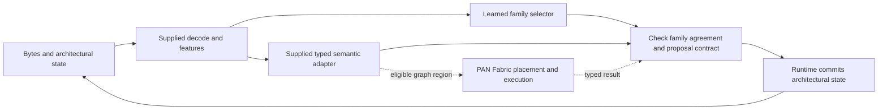

# Early PAN-ISA instruction execution

*A source-grounded study of the June 2026 proof of concept and its typed runtime lineage. Written October 30, 2026.*

## What the early work established

Early PAN-ISA demonstrated that a learned component could participate in a bounded machine-instruction executor while registers, flags, memory, control flow, and selected exceptions remained explicit. Its strongest result combines executable state transitions with inspection and independent emulator comparisons. Its principal learned components selected structured semantic candidates. The supplied code still computed most arithmetic and memory effects.

An **instruction set architecture (ISA)** specifies the instructions a machine exposes and how they affect architectural state. x86 is an ISA; QEMU is software that emulates it. Comparing with an actual processor means measuring native CPU execution of a matched workload, a separate baseline from QEMU's software emulation.

That boundary explains both the achievement and the remaining question. Correct selection can support correct continuous execution without establishing that a network learned addition, division, floating-point arithmetic, or all of x86. An optional Stage 0 effect model moves farther: it predicts small-word values and write masks that its validator commits. It remains a different experiment from the selector-based Stage 3 timing result.

The [June 19 whitepaper](sources/WHITEPAPER-PAN-ISA.md) proposes a larger system that learns architectural effects and delegates execution placement to PAN Fabric. This article separates that proposal from measurements. Its dated coverage baseline is the [June 17 status reconciliation](evidence/pan_isa_exact_status.md); implementation details come from source snapshots captured on October 30. Later runtime additions therefore do not silently enlarge June's validated stage scopes. The [companion study](../learned-isa/README.md) covers the newer learned-ISA work and its architecture comparisons.

## Instructions as typed changes to state

An instruction is more than an opcode label. Adding into a partial register can change some bits, preserve others, define several flags, and advance the instruction pointer. A memory operation adds addresses, access widths, permissions, and possible faults. A call changes both control flow and stack memory.

PAN-ISA represents the intended computation as

$$
(b,s_t,p)\longrightarrow \Delta_t\longrightarrow s_{t+1}.
$$

Here $b$ is the instruction byte sequence, $s_t$ is architectural state before execution, $p$ is the machine profile, and $\Delta_t$ is a typed proposal containing changes. A profile names assumptions such as 64-bit mode, privilege, and available instruction features. A proposal can carry register values and masks, flag values and definedness, memory events, a next instruction pointer, or a stop outcome. The runtime validates its contract before committing changes.

This is a useful separation of responsibilities. The model can propose; the runtime owns mutation. A masked register commit has the form

$$
r'=(r\mathbin{\&}\neg M)\mathbin{|}(v\mathbin{\&}M),
$$

within the register's fixed width. $r$ is the old value, $v$ the proposed value, and $M$ the write mask. Bits outside the mask remain unchanged by construction. Flag definedness needs its own channel: a stored zero or one does not necessarily mean that the preceding instruction promises a usable flag value.

The [proposal validator](sources/code/transitions.py) checks properties including profile compatibility, finite confidence, stage metadata, supported register names, value widths, canonical addresses, and memory-event sizes. [Runtime commit](sources/code/runtime.py) applies masks and state updates. These are concrete engineering safeguards. They do not independently prove every arithmetic result: a wrong but well-formed integer can satisfy a type contract. Numerical semantics still depend on the selected implementation and the external validation evidence.

## Network architectures and mathematics

The early implementation contains several ordinary feed-forward networks. The name PAN should not be used to infer an attention mechanism, recurrent machine, spiking network, or an unspecified universal architecture.

**Stage 0 has three distinct variants.** The dense `Stage0PAN` uses learned opcode and register embeddings plus supplied periodic value features. For word width $w$, let $m=2^w$. Its phase representation is

$$
\phi(v)=\left[\cos(2\pi kv/m),\sin(2\pi kv/m)\right]_{k=1}^{f},
$$

where $v$ is an integer value and $f$ is the configured frequency count, capped by the implementation. The input concatenates phases of four register values, current flags, destination/source/immediate phases, **precomputed** destination-plus-source and destination-minus-source phases, a 24-dimensional opcode embedding, and two 8-dimensional register embeddings. Two hidden linear layers with GELU activations feed categorical register-value and binary flag outputs. The default hidden width is 192. The phase table is supplied and fixed; the network learns embeddings and affine-layer weights. Even the dense model receives arithmetic-derived features. [Network source](sources/code/stage0_networks.py.txt)

`FactorizedStage0PAN`, used by the preserved width-8 result, changes the learning problem. A 32-dimensional opcode embedding feeds two separate `32 → 192 → 192` GELU MLPs. Their outputs score **17 supplied value candidates** and **15 supplied flag candidates**. Code computes candidates such as addition, addition with carry, subtraction, bitwise operations, and one-bit shifts and rotations. Candidate scores are scattered into categorical output bins; when multiple candidates yield the same value, the implementation keeps the maximum score. Destination and write policy come from supplied instruction metadata. This model learns which available computation to use, while the operand-dependent arithmetic is already implemented.

`EffectStage0PAN` shares the dense phase-feature body but adds four heads: register write masks, register values, flag write masks, and flag values. Its [commit function](sources/code/stage0_effect_commit.py.txt) consumes predicted masks and values. This is a meaningful move toward direct effects, although the inputs still include supplied arithmetic features. The configurable organism supports 3–8-bit words and defaults to 4 bits; the width-8 selector report cannot be cited as an effect-head result or as learned full-width x86 arithmetic.

**Stages 1–4 retain explicit factorization.** [Stage 1](sources/code/stage1_network.py.txt) embeds the operation in 16 dimensions and uses two width-64 GELU MLPs to score register-value-source and memory-event candidates. [Stage 2](sources/code/stage2_network.py.txt) concatenates a 24-dimensional operation embedding with current flags, uses a width-96 body, and has heads with 3, 5, 4, and 4 choices for instruction-pointer, stack, register, and flag policies. [Stage 4](sources/code/stage4_network.py.txt) uses a 32-dimensional operation embedding and a `32 → 96 → 96 → number-of-forms` GELU network. These selectors do not emit arbitrary wide register values.

Stage 3 makes the boundary particularly clear. Its `FactorizedStage3PAN` receives an operation index that has already been supplied by the trace representation, embeds it in 32 dimensions, and appends four flag bits. Its actual default network is

$$
x=[E[o];F],\qquad
z=W_3\,g(W_2\,g(W_1x+b_1)+b_2)+b_3,
$$
$$
\hat o=\arg\max_j z_j,\qquad
s_{t+1}=T_{\hat o}(s_t,d).
$$

$E$ is the learned embedding; $o$ the supplied operation index; $F$ the four current flags; $g$ GELU; and $d$ supplied operand metadata. The layer widths are `36 → 96 → 96 → 125`. The learned choice $\hat o$ selects $T$, implemented by `apply_op` and `apply_memory_effect`. Neither register operands nor the memory contents enter this selector MLP. They enter the deterministic transition routine afterward. `EffectStage3PAN` subclasses this selector without adding a direct 64-bit value head. [Selector and semantic handoff](sources/code/stage3_selector.py.txt)

The runtime neural head is another component, rather than the same Stage 3 model. It embeds up to 15 byte tokens with a `256 × 8` table, flattens them, appends 42 engineered numeric features, and applies `162 → 96 → 96 → 33` linear layers with ReLU between hidden layers. Numeric inputs include prefix/REX information, decoded widths and ModRM fields, memory alignment, and x87 context. Its output is a form label and softmax confidence. The supplied decoder has already contributed structure. The adapter asks `BootstrapSPFTransitionModel` for the concrete proposal and rejects disagreement between its instruction name and the predicted label. This establishes learned family selection, not learned arithmetic payloads. [Runtime features, network, and handoff](sources/code/neural_runtime.py)

## A worked addition

Consider an illustrative width-8 Stage 0 operation, `ADD AL, CL`, with `AL=250`, `CL=10`, and `DL` and `BL` holding arbitrary values. The byte form `00 c8` encodes this low-byte register addition; the staged model receives the parsed operation and operand identities rather than learning the entire byte decoder.

For $m=256$, the supplied candidate computes

$$
u=250+10=260,\qquad y=u\bmod256=4.
$$

The selected addition flag routine produces carry $CF=[u\ge256]=1$, zero $ZF=[y=0]=0$, sign $SF=[y\mathbin{\&}128\ne0]=0$, and overflow $OF=0$. Signed overflow is absent because the input signs differ: 250 represents −6 in eight-bit two's complement, so −6+10=4 is representable. These are the four flags tracked by this organism, not the complete x86 flag set.

The factorized network's job is to assign the addition candidate a winning output score and choose the corresponding flag candidate. It did not calculate 260 from unconstrained learned arithmetic. Supplied metadata identifies `AL` as writable, so `CL`, `DL`, and `BL` are preserved. On a following `ADC`, the committed carry can become an input to the next operation. That is continuous state feedback, even though the numeric transition came from supplied candidates.

The alternative effect head must emit the write decisions as well as values: write `AL=4`, preserve the other modeled registers, and write the four tracked flags. That shifts responsibility toward the learner. This example explains the code paths; it is not a newly measured inference result for a particular checkpoint.

The preserved [width-8 validation report](evidence/stage0_w8_validation_report.json) supplies the actual observation: 500 held-out-immediate programs comprising 1,652 steps, and 200 longer held-out-register-tuple programs comprising 6,400 steps, reached reported step and final exactness of 1.0. Unicorn agreed on all 8,052 checked validation/long steps. Byte-stream overlap with training was zero for those two splits. Scrambled-opcode validation exactness was 0.010291; scrambled-flags exactness was 0.065981. The [control constructor](sources/code/stage0_controls.py.txt) uses altered **structured predictors**, not interventions on the frozen neural model. These controls show the structured execution path's sensitivity to wrong opcode/flag behavior; they do not establish causal sensitivity of the learned weights, remove supplied candidate semantics, or establish unrestricted x86 generalization.

## How the stages grew

The June status report distinguishes each stage's operand scope from full instruction-form closure. The counts below are the **historical June 17 report's** implemented forms, not a newly enumerated October inventory.

| Stage | Reported scope | What remained supplied or bounded |
|---|---|---|
| 0 | 25 low-byte ALU forms; selected flags | Candidate arithmetic and write policy in the factorized result |
| 1 | 16 memory/addressing forms | Flat mapped load/store/XCHG semantics; restricted memory environment |
| 2 | 18 control/stack forms | Bounded flat stack, branch targets, call/return policies |
| 3 | 125 complex-scalar forms | Four GPRs, four flags and definedness, selected 256-byte memory image |
| 4 | 268 manifest forms over XMM0–XMM15 | Selected SSE/SSE2 and floating behavior; restricted exception/FP scope |
| 5 | Cumulative Stage 0–4 composition | Existing semantic cartridges, not full x86 or a general process runtime |

Stages 0–4 have reported scoped validation and long-split exactness of 1.0. Independent QEMU evidence covers accepted stage subsets, with Bochs used for Stage 2 and selected scalar/SIMD or exception checks. Counts of cases and oracle applicability matter: the status report lists 768 QEMU cases each for Stages 0 and 1, and 768 each for QEMU and Bochs in Stage 2. The stage totals should not be summed into a universal x86 coverage number. They use different scopes, state surfaces, and validation units. [Dated coverage source](evidence/pan_isa_exact_status.md)

Stage 3's evolution exposes why continuous state matters. The historical v21 artifact had perfect isolated-step scores yet allowed later `RCL` or `RCR` instructions to consume carry after a predecessor left it undefined. A stronger stream-safety check rejected that artifact. The reconciled report identifies v22 as the corrected artifact, with zero continuous undefined-flag reads on validation and long splits while retaining exactness. The v21 scores remain historical observations. Their later certification failure identifies an invalid stream assumption; it does not erase the learned selection result or imply that every transition was wrong.

Stage 5 reportedly touched GPRs, flags and definedness, RIP/RSP, branches, calls/returns, data/stack/SIMD memory, and XMM state. Its wrong-stack, wrong-scalar-opcode, and wrong-XMM-source controls reached exactness 0.388889, 0.666667, and 0.833333 respectively. Those heterogeneous outcomes are more informative than a single aggregate pass label. The v22 and Stage 5 particulars are reported results; their raw artifacts were unavailable locally. See the [source note](sources/README.md).

The [full-ISA ledger report](evidence/full_isa_user64_report.json) is stricter still: of 8,863 classified XED rows, it lists 1,088 executable `user64` rows, 370 with operand-subset learned/validated evidence, one fully validated row, and 718 unimplemented rows. Its one named full promotion is `ADDPS_XMMps_XMMps`. Full-form closure therefore remained narrow even where stage-specific validation was strong; accounting and provenance qualifications are preserved in the [source note](sources/README.md).

June Stage 4 explicitly excludes x87, AVX/VEX/EVEX, YMM/ZMM, MMX, masks, and broad floating-point corner cases. Later runtime source includes narrow x87 labels such as `FNOP`, `FLD1`, `FLDZ`, and `FSTP_ST`; those do not retroactively validate x87 in the June stage manifest. Full privilege, interrupts, paging, segmentation, vendor/profile variation, and complete exception priorities also remain outside the early result.

## Typed runtime and PAN Fabric

The runtime lineage adds practical machine behavior. The report describes loading simple static x86-64 ELF programs, a sparse permissioned memory model, and GDB access. Register edits changed a function result; changing a saved return address changed subsequent control flow. An invalid return reached an unmapped address and produced a fault. These are useful observations that the executor consumes mutable architectural state rather than replaying a fixed answer sequence.

The process environment remains bounded: no dynamic linking/PIE, complete threading, signals, or general Linux compatibility. The reported syscall subset includes `read`, `write`, memory mapping/protection operations, `brk`, `getpid`, `arch_prctl`, and exits. Unsupported instructions or system behavior stop explicitly. A separate PAN debugger feature could map memory at a fault address and inject executable bytes; that is model surgery, not an ordinary user-process capability. [Runtime and debugger findings](evidence/pan_isa_exact_status.md)

*The solid path describes the runtime classifier/adapter boundary. Fabric is an additional execution route, not a prerequisite for the Stage 3 benchmark.*

SPF has specific implementation roles. The [runtime backend](sources/code/spf_backend.py) constructs SPF identity, low-rank selector, and identity-transport objects under a strict execution policy. Their presence establishes use of those interfaces, not a learned universal ALU.

The [Stage 3 SPF experiment](sources/code/benchmark_stage3_spf_v2.py) does something more directly measurable. Its selector sees only 125 operation IDs and four binary flags, so its input domain has $125\times2^4=2{,}000$ combinations. The harness evaluates that domain, records the selected class in a `125 × 16` table, encodes it through SPF tensor representations, routes it through per-operation block-matrix objects, and checks exact recovery. The default timed `compiled` route indexes the materialized routed table. It does not run a neural forward pass or a block-matrix multiply at every instruction. Numeric effects still pass through the Stage 3 semantic routines.

PAN Fabric addresses another question: where an eligible computation should run. The [Fabric design](sources/WHITEPAPER-PAN-FABRIC.md) separates processor-side execution (PS) from programmable logic (PL), daemon-resident paths, catalog cores, and generated fabric. The ISA runtime remains authoritative for architectural commit. A graph executor returning typed outputs can preserve that ownership while changing placement. Neither the graph hooks nor the intended learned scheduler establish a measured FPGA speedup for the instruction benchmark discussed here.

## Size and performance

There is no single meaningful “PAN size.” Count model weights, serialized artifacts, selector tables, and process memory separately.

From its actual default layer dimensions, Stage 3 has

$$
125\cdot32+(36+1)96+(96+1)96+(96+1)125
=28{,}989
$$

trainable parameters. The `+1` terms count biases. At float32 that is 115,956 bytes of parameter values alone, excluding serialization, Python, Torch, state, and traces. The default factorized Stage 0 module has 93,792 trainable parameters, including an allocated register embedding that does not participate in its selector computation; its phase buffer is not trainable. The default 33-class runtime classifier has 30,209 parameters, or 120,836 float32 parameter bytes. These are source-derived configuration counts, not measured resident memory or counts recovered from the unavailable benchmark checkpoint.

The [SPF comparison JSON](evidence/pan_isa_spf_v2_comparison.json) reports the same 8,192-instruction program, with 52,373 program bytes, for the following comparison:

| Reported engine path | Recorded elapsed seconds | Steps/s | Recorded storage bytes | Recorded RSS bytes |
|---|---:|---:|---:|---:|
| PAN Stage 3 v1, comparison rerun | 0.648707 | 12,628.19 | 129,869 | 420,593,664 |
| PAN Stage 3 SPF v2, compiled table | 0.369115 | 22,193.60 | 140,384 | 427,950,080 |
| QEMU, reused report | 0.165826 | 49,401.23 | 1,477,781 | 37,830,656 |

All rows report exact acceptance and final agreement. QEMU was 3.912 times faster than the PAN v1 rerun and 2.226 times faster than SPF v2 on these recorded times. The earlier uninterrupted report records PAN at **0.599302 seconds**, or 13,669.23 steps/s, making QEMU about **3.61 times faster**. These are two PAN measurements, not interchangeable versions of the same timing.

Several scope qualifications determine what the table means. PAN times cover Python execution loops, excluding model loading and SPF compilation; SPF compilation separately took 0.371772 seconds. The [QEMU timing helper](sources/code/qemu_until_serial_result.py) spans process launch, guest execution and final checks, serial-result polling, and process termination. Thus the recorded ratios compare these harness paths, not equally isolated instruction kernels or intrinsic CPU throughput. The original QEMU child report is unavailable here for a finer timing decomposition.

The 2,000-word SPF selector encoding occupies 8,000 bytes, not an entire execution engine. The report's storage accounting includes a Stage 3 checkpoint for PAN, adds the materialized table for SPF v2, and counts an image/report directory for QEMU. It cannot support a model-versus-emulator compression ratio. The comparison builder's field named `max_rss_bytes` takes PAN's **post-run RSS snapshot** but QEMU's **sampled child maximum**. PAN includes Python/Torch; QEMU covers the emulator child. These are differently defined observed footprints, not comparable peak-memory measurements. The original field name is retained unchanged in the evidence snapshot.

The [uninterrupted harness](sources/code/benchmark_stage3_uninterrupted.py) also reveals an accuracy-instrument asymmetry. PAN compares every predicted step with expected state and feeds its predicted registers, flags, and memory into the next step. The QEMU guest runs the same instruction bytes uninterrupted, checks final registers, defined flags, RIP, and memory, then emits a success record labeled with the program length. Its reported “8,192 exact steps” is therefore a final-state acceptance summary, not 8,192 separately instrumented QEMU state comparisons. Final agreement is real evidence; the two observation procedures should remain distinct.

The records do not provide repeated-run timing distributions or a matched native-x86 hardware baseline for this early experiment. QEMU executes an x86 guest ISA in an emulator; its timing is not a measurement of an actual x86 processor running the workload natively. The newer study's hardware results belong to its own workloads, architecture, and boundaries and cannot be inserted into this table as a third comparable machine.

## What the evidence suggests

The convergent early trend is that small learned selectors can compose supplied instruction semantics into inspectable continuous execution, and that explicit state contracts expose errors hidden by isolated-step scores. Width-8 held-out programs, independent emulator checks, debugger mutations, and the uninterrupted Stage 3 run support that interpretation through different instruments.

The bounded execution results are stronger than classification alone, because later steps consume committed state. The bounded learning result is narrower than full learned semantics, because most committed values come from supplied routines. Faster table routing is useful evidence about implementation overhead; it does not establish faster neural arithmetic or superiority to QEMU. Complete x86 coverage and general native-hardware performance remain unestablished by these early records.

The next scientific boundary is the one the effect experiment began to cross: learn values, write decisions, memory events, and definedness that subsequent instructions actually consume, while retaining the same inspectable state interface. The [newer learned-ISA study](../learned-isa/README.md) follows that progression with different architectures and evidence rather than treating the early selector system as its completed endpoint.
